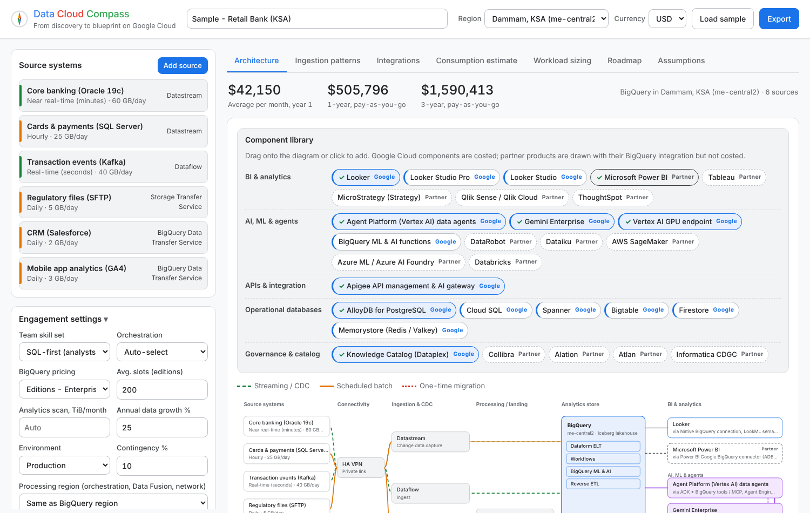
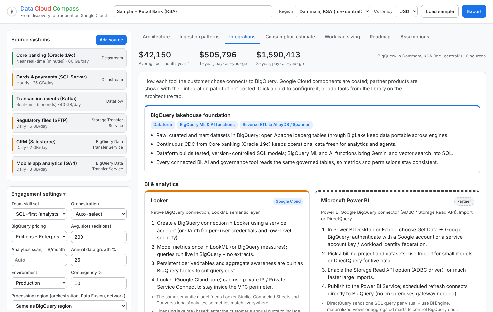
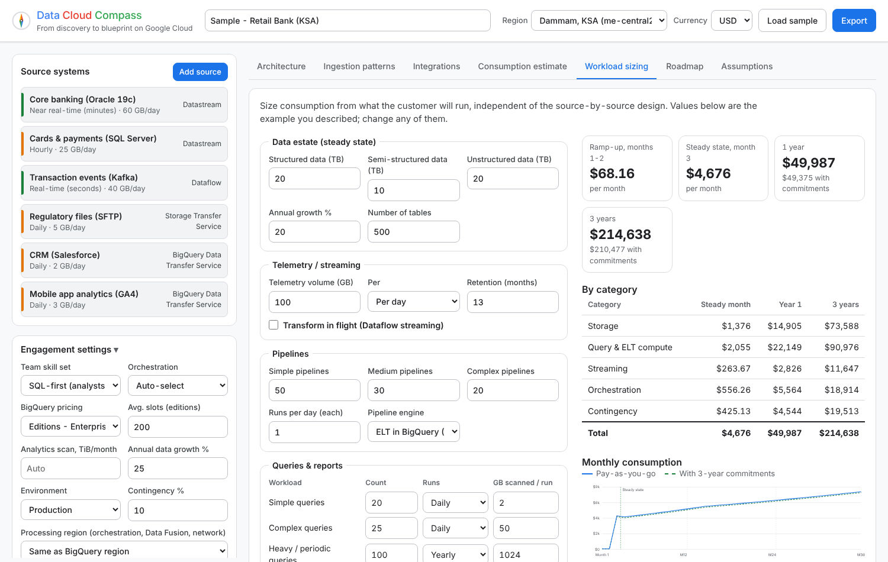
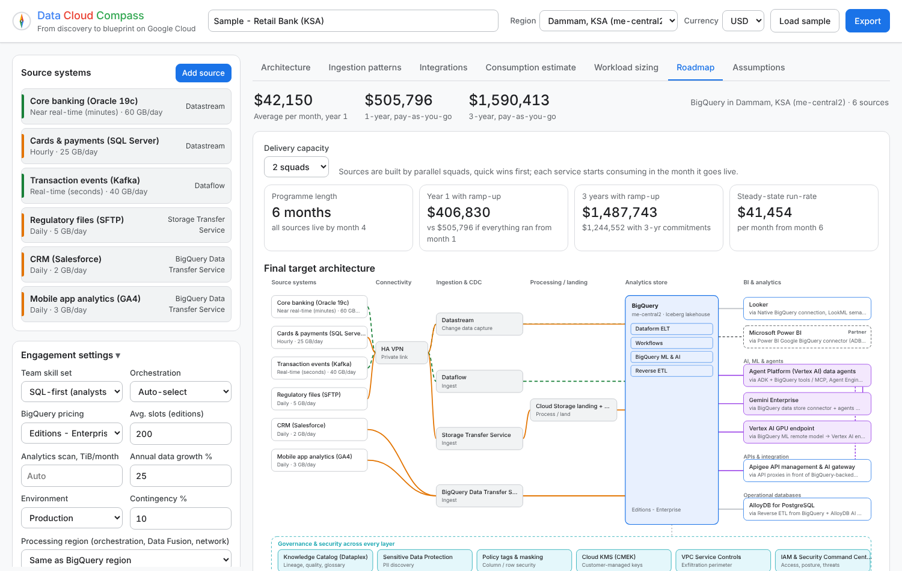

# Data Cloud Compass

**From discovery to blueprint on Google Cloud.** A tool for Data & AI architects to use live in customer discovery sessions. Add the customer's source systems and the tools they already use, and Data Cloud Compass:

- **draws the target architecture** live: sources → connectivity → CDC / batch ingestion → BigQuery → BI, AI, APIs and operational databases, with governance and security across every layer;
- **recommends GCP-native ETL / ELT per source** (Datastream, Dataflow templates, Pub/Sub BigQuery subscriptions, BigQuery Data Transfer Service, Data Fusion, Dataproc Serverless, Storage Transfer, BigQuery Connector for SAP, Mainframe Connector …) based on source type, data type, freshness, location, transformation needs and team skills, with rationale, alternatives and discovery caveats;
- **lets you drag and drop the consumption layer** from a component library:
  - *Google Cloud (costed)*: Looker, Looker Studio (Pro), Agent Platform data agents, Gemini Enterprise, Vertex AI GPU endpoints, BigQuery ML, **Apigee** API management & AI gateway, **AlloyDB, Cloud SQL, Spanner, Bigtable, Firestore, Memorystore**, Knowledge Catalog (Dataplex);
  - *Partners (shown with their BigQuery integration, never costed)*: Power BI, Tableau, MicroStrategy, Qlik, ThoughtSpot, DataRobot, Dataiku, AWS SageMaker, Azure ML / AI Foundry, Databricks, Collibra, Alation, Atlan, Informatica;
- **explains every integration** - how each tool connects to BigQuery, step by step, with best practices and documentation links;
- **prices each service in its own region** - BigQuery in one data centre, ingestion or GPU endpoints in another - and adds cross-region transfer where data moves;
- **estimates 1-year and 3-year consumption**, pay-as-you-go and with committed-use discounts, by service, capability, region and source, in USD, SAR, AED, EUR, GBP or INR;
- **sizes from workloads** (Workload sizing tab): pipelines, simple/complex/periodic queries, ad-hoc reports, dashboards, data by type, telemetry and a ramp-up phase;
- **builds a month-by-month roadmap** (Roadmap tab): final architecture, phased plan by delivery squads, go-live per source and component, and ramped monthly consumption;
- **exports** a Markdown proposal, CSV cost breakdown, architecture SVG, scenario JSON or a print-ready PDF.



| Integrations | Workload sizing | Roadmap |
|---|---|---|
|  |  |  |

---

## Deploy in a few clicks

### Option 1 - Open in Cloud Shell (recommended)

[](https://shell.cloud.google.com/cloudshell/editor?cloudshell_git_repo=https://github.com/jithinsl27/jithinsl27-gcp-ingestion-advisor&cloudshell_tutorial=docs/cloudshell-tutorial.md&show=terminal)

Or paste into any Cloud Shell:

```bash
git clone https://github.com/jithinsl27/jithinsl27-gcp-ingestion-advisor.git
cd jithinsl27-gcp-ingestion-advisor
./deploy.sh --region us-central1        # add --private to require IAM sign-in
```

The script enables the required APIs, builds the container with Cloud Build (no local Docker needed) and deploys to Cloud Run. It prints the URL when it finishes (about 3 minutes the first time). Run only one `./deploy.sh` command at a time.

### Option 2 - Run on Google Cloud button

[](https://deploy.cloud.run/?git_repo=https://github.com/jithinsl27/jithinsl27-gcp-ingestion-advisor)

### Option 3 - CI/CD and infrastructure as code

- `cloudbuild.yaml` - test, build, push to Artifact Registry and deploy (Cloud Build trigger on `main`).
- `deploy/terraform/` - Artifact Registry, Cloud Run v2 service, runtime service account, invoker IAM and an optional Cloud Build trigger.
- `.github/workflows/deploy.yml` - deploy from GitHub Actions with Workload Identity Federation.

Details, private access with IAP and troubleshooting: [docs/deployment.md](docs/deployment.md).

### Static demo (no Google Cloud project needed)

`python demo/build_demo.py` produces `demo/dist/index.html`: the whole tool in one file, running in the browser with a JavaScript port of the engine. The `pages.yml` workflow publishes it to GitHub Pages (enable **Settings → Pages → Source: GitHub Actions**) at `https://jithinsl27.github.io/jithinsl27-gcp-ingestion-advisor/`. A parity test keeps the JavaScript engine identical to the Python one.

---

## Run locally

```bash
python -m venv .venv && source .venv/bin/activate
pip install -r requirements-dev.txt
uvicorn app.main:app --reload --port 8080      # open http://localhost:8080
python -m pytest -q                            # engine, API and JS/Python parity tests (parity needs node)
```

## How it works

```
Browser (app/static)  ──/api/estimate · /api/workload · /api/plan──▶  FastAPI (app/main.py)
  diagram, component library (drag & drop),                          ├─ recommender.py  source → ingestion pattern
  tabs, exports                                                       ├─ components.py   BI / AI / API / DB / governance library + costs
                                                                      ├─ estimator.py    36-month, multi-region consumption model
                                                                      ├─ workload.py     workload-based sizing
                                                                      ├─ plan.py         ramp-up roadmap + ramped costs
                                                                      └─ data/*.json     list prices, regions (editable)
```

- **Stateless.** Nothing is stored server-side; scenarios live in the browser and can be saved/opened as JSON.
- **Transparent rules.** Recommendation, sizing and planning rules are plain Python you can tune.
- **Editable prices.** `app/data/pricing.json` and `app/data/regions.json` hold list prices and regional uplifts.

## Documentation

| Document | What's in it |
|---|---|
| [User guide](docs/user-guide.md) | Running a discovery session, every tab and field explained |
| [Demo script](docs/demo-script.md) | A 15-minute customer demo storyline |
| [Decision matrix](docs/decision-matrix.md) | Which GCP tool is recommended for which source, and how each component integrates |
| [Pricing model](docs/pricing-model.md) | Sizing formulas, regions, workload and roadmap assumptions, price sources |
| [Architecture](docs/architecture.md) | Code structure, API, extending sources, components and rules |
| [Deployment](docs/deployment.md) | Cloud Shell, Cloud Run button, Cloud Build, Terraform, GitHub Actions, IAP |

## Important

Estimates are **ballpark figures for discovery conversations**, based on public list prices (reviewed 2026-10-15) and approximate regional uplifts. They exclude taxes, support, egress from other clouds, partner licences (Power BI, Tableau, SageMaker and the other partner tools are never costed; Looker is quote-based) and negotiated discounts. Validate with the [Google Cloud Pricing Calculator](https://cloud.google.com/products/calculator) before sharing numbers formally.

## License

Apache 2.0 - see [LICENSE](LICENSE).
