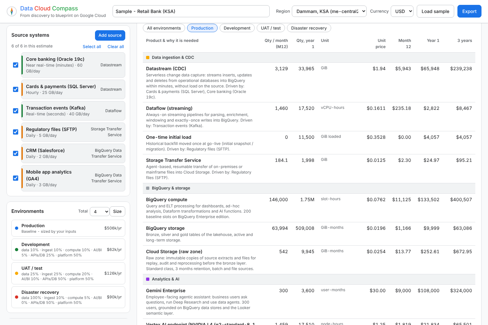

# Data Cloud Compass

**From discovery to blueprint on Google Cloud.** A tool for Data & AI architects to use live in customer discovery sessions. Add the customer's source systems and the tools they already use - by hand, through a **guided interview**, from **meeting notes (Gemini)** or an **inventory spreadsheet** - and Data Cloud Compass:

- **draws the target architecture** live: sources → connectivity → CDC / batch ingestion → **Cloud Storage raw zone** → BigQuery **bronze / silver / gold** → BI, AI, APIs and operational databases, with governance and security across every layer;
- **recommends GCP-native ETL / ELT per source** (Datastream, Dataflow templates, Pub/Sub BigQuery subscriptions, BigQuery Data Transfer Service, Data Fusion, Dataproc Serverless, Storage Transfer, BigQuery Connector for SAP, Mainframe Connector …) based on source type, data type, freshness, location, transformation needs and team skills, with rationale, alternatives and discovery caveats;
- **lets you search and add the consumption, governance and security layers** by product name:
  - *Google Cloud (costed)*: Looker, Looker Studio (Pro), Agent Platform data agents, Gemini Enterprise, Vertex AI GPU endpoints, BigQuery ML, **Apigee** API management & AI gateway, **AlloyDB, Cloud SQL, Spanner, Bigtable, Firestore, Memorystore**, Knowledge Catalog (Dataplex);
  - *Security & compliance*: Sensitive Data Protection, Cloud KMS (CMEK), VPC Service Controls, policy tags & masking, Security Command Center, Assured Workloads;
  - *Partners (shown with their BigQuery integration, never costed)*: Power BI, Tableau, MicroStrategy, Qlik, ThoughtSpot, DataRobot, Dataiku, AWS SageMaker, Azure ML / AI Foundry, Databricks, Collibra, Alation, Atlan, Informatica;
- **wires Gemini Enterprise and Apigee the way the customer wants**: drag Gemini Enterprise onto Looker or BigQuery (or route it through agents), and Apigee onto the source systems (integration layer) or an agent (AI gateway);
- **IoT options**: Google Cloud native (Pub/Sub, MQTT broker on GKE, Manufacturing Data Engine) or ISVs such as Litmus Edge and ClearBlade;
- **sizes every environment**: choose the number of environments (production, development, UAT, pre-production, DR, sandbox …) and size each one per capability;
  every sizing parameter is explained and editable on the Consumption estimate tab, next to the resulting per-environment specification (quantities and cost at month 12), including **running hours per week** so part-time dev/test environments are priced realistically;
- **sizes BigQuery the way it is billed**: on-demand per TiB, or an edition (Standard / Enterprise / Enterprise Plus, or let the tool recommend) with a **baseline** (commitment-eligible) and **autoscaling max**, auto-sized per environment from the data and workload and **editable** anywhere; an edition comparison, the hourly demand profile, and calibration from the customer's own `INFORMATION_SCHEMA` usage;
- **lets you choose what is priced** - tick sources in or out for a phased estimate, switch individual products or service lines off without removing them from the architecture;
- **explains every integration** - how each tool connects to BigQuery, step by step, with best practices and documentation links;
- **prices each service in its own region** - BigQuery in one data centre, ingestion or GPU endpoints in another - and adds cross-region transfer where data moves;
- **estimates 1-year and 3-year consumption**, pay-as-you-go and with committed-use discounts, by service, capability, region and source, in USD, SAR, AED, EUR, GBP or INR - with **live Google Cloud list prices** (Cloud Billing Catalog, refreshed daily on Cloud Run), negotiated discount, **Customer Care** plan and an editable discussion range;
- **checks regional availability**: warns when a service is not offered in the region it is placed in and offers a one-click move to a nearby region;
- **sizes from workloads** (Workload sizing tab): pipelines, simple/complex/periodic queries, ad-hoc reports, dashboards, data by type (KB … ZB), telemetry and a ramp-up phase - and **sizes BigQuery slots** (baseline, autoscale max, edition, commitment) with recommendations;
- **itemises the bill of materials**: product, quantity, unit, unit price, cost and why each service is needed, per environment;
- **prices by your chosen option**: switch between pay-as-you-go, 1-year commitment and 3-year commitment pricing; every figure, breakdown, environment cost, bill of materials and export follows the choice, with the saving versus pay-as-you-go;
- **drills into every headline figure**: click the monthly, 1-year or 3-year total to see each product's quantity, unit price, cost and share, for all or one environment. Nothing is priced until a source system or a Google Cloud product is added;
- **saves scenarios to the cloud** (Firestore, Google sign-in): version history, share with people or by link, view-only or edit, and **compare** any two scenarios or versions side by side;
- **builds a month-by-month roadmap** (Roadmap tab): final architecture, phased plan by delivery squads, go-live per source and component, and ramped monthly consumption;
- **exports to Google Sheets and Google Slides** (architecture, bill of materials, sizing and native charts) - directly into the user's Google Drive, or as .xlsx / .pptx files - plus a Markdown proposal, CSV, architecture SVG, scenario JSON or a print-ready PDF.


| Bill of materials | Slot sizing | Roadmap |
|---|---|---|
|  |  |  |

---

## Deploy in a few clicks

### Option 1 - Open in Cloud Shell (recommended)

[](https://shell.cloud.google.com/cloudshell/editor?cloudshell_git_repo=https://github.com/jithinsl27/jithinsl27-gcp-ingestion-advisor&cloudshell_tutorial=docs/cloudshell-tutorial.md&show=terminal)

Or paste into any Cloud Shell:

```bash
git clone https://github.com/jithinsl27/jithinsl27-gcp-ingestion-advisor.git
cd jithinsl27-gcp-ingestion-advisor
./deploy.sh --project YOUR_PROJECT --region us-central1
# then, to turn on sign-in (saving, sharing, AI assist, Drive export):
./deploy.sh --project YOUR_PROJECT --region us-central1 --oauth-client-id CLIENT_ID [--allowed-domains yourcompany.com]
```

The script enables the APIs, creates Firestore, a least-privilege runtime service account and a Cloud Billing API key (kept in Secret Manager) for live prices, builds the container with Cloud Build (no local Docker) and deploys to Cloud Run. It prints the URL and the next steps (about 3 minutes the first time). It is safe to re-run for every release. The OAuth client ID is created once in the console (APIs & Services → Credentials → OAuth client ID → Web application) with the Cloud Run URL and your GitHub Pages URL as authorised JavaScript origins.

**Automatic deploys from GitHub:** run `./setup-github-deploy.sh --project YOUR_PROJECT --region us-central1` once in Cloud Shell. It creates a keyless Workload Identity connection trusted only by this repository and sets the repository variables; from then on every push to `main` is tested and deployed.

### Option 2 - Run on Google Cloud button

[](https://deploy.cloud.run/?git_repo=https://github.com/jithinsl27/jithinsl27-gcp-ingestion-advisor)

### Option 3 - CI/CD and infrastructure as code

- `cloudbuild.yaml` - test, build, push to Artifact Registry and deploy (Cloud Build trigger on `main`).
- `deploy/terraform/` - Artifact Registry, Cloud Run v2 service, runtime service account, invoker IAM and an optional Cloud Build trigger.
- `.github/workflows/deploy.yml` - test and deploy on every push to `main` with Workload Identity Federation (set up by `setup-github-deploy.sh`).

Details, private access with IAP and troubleshooting: [docs/deployment.md](docs/deployment.md).

### Public demo (GitHub Pages)

**Live demo: https://jithinsl27.github.io/jithinsl27-gcp-ingestion-advisor/**

There is one pricing engine - the Python service. The demo is the same front end published to GitHub Pages and calling your Cloud Run service (cross-origin; the estimate endpoints store nothing and need no sign-in). Set the repository variable `COMPASS_API_URL` to the Cloud Run URL (`deploy.sh` prints the command); `pages.yml` rebuilds the demo on every push to `main`.

---

## Run locally

```bash
python -m venv .venv && source .venv/bin/activate
pip install -r requirements-dev.txt
uvicorn app.main:app --reload --port 8080      # open http://localhost:8080
python -m pytest -q                            # engine, API and browser tests (browser tests need: python -m playwright install chromium)
AUTH_DEV_USER=me@example.com uvicorn app.main:app --port 8080   # try saving / sharing locally (in-memory store, no Google sign-in)
```

## How it works

```
Browser (app/static/js/*.js, ES modules)            FastAPI on Cloud Run (app/main.py)
  diagram, BigQuery panel, tabs, discovery,   ──▶   ├─ recommender.py   source → ingestion pattern
  compare, exports, sign-in                         ├─ components.py    BI / AI / API / DB / governance library + costs
                                                    ├─ estimator.py     36-month, multi-region consumption model
GitHub Pages demo (same files) ── CORS ──▶          ├─ slots.py         BigQuery editions: baseline + autoscale sizing
                                                    ├─ workload.py      workload-based sizing
                                                    ├─ plan.py          ramp-up roadmap + ramped costs
                                                    ├─ live_pricing.py  Cloud Billing Catalog: prices + availability (daily)
                                                    ├─ store.py         Firestore: scenarios, versions, sharing
                                                    ├─ assist.py        Gemini on Vertex AI + spreadsheet import
                                                    └─ data/*.json      reviewed list prices, regions (fallback)
```

- **Open estimates, signed-in storage.** `/api/estimate`, `/api/workload`, `/api/plan`, `/api/compare` store nothing and need no sign-in; saving, sharing and the AI assist require a Google sign-in (optionally limited to your domains).
- **Transparent rules.** Recommendation, sizing and planning rules are plain Python you can tune; every BigQuery assumption is editable in the app.
- **Prices you can trust and trace.** Live list prices from the Cloud Billing Catalog when deployed (status at `/api/pricing/status`), falling back to the reviewed `app/data/pricing.json`; the app always says which it used.

## Documentation

| Document | What's in it |
|---|---|
| [User guide](docs/user-guide.md) | Running a discovery session, every tab and field explained |
| [Demo script](docs/demo-script.md) | A 15-minute customer demo storyline |
| [Decision matrix](docs/decision-matrix.md) | Which GCP tool is recommended for which source, and how each component integrates |
| [Pricing model](docs/pricing-model.md) | Sizing formulas, regions, workload and roadmap assumptions, price sources |
| [Architecture](docs/architecture.md) | Code structure, API, extending sources, components and rules |
| [Deployment](docs/deployment.md) | Cloud Shell, Cloud Run button, Cloud Build, Terraform, GitHub Actions, IAP |

## Important

Estimates are **ballpark figures for discovery conversations**, based on public list prices (live from the Cloud Billing Catalog when deployed, otherwise reviewed 2026-10-15). Negotiated discounts and Customer Care are included only when you enter them. They exclude taxes, egress from other clouds and partner licences (Power BI, Tableau, SageMaker and the other partner tools are never costed; Looker is quote-based). Validate with the [Google Cloud Pricing Calculator](https://cloud.google.com/products/calculator) before sharing numbers formally.

## License

Apache 2.0 - see [LICENSE](LICENSE).
