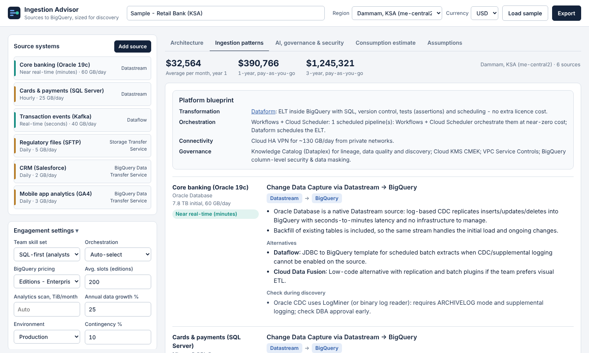
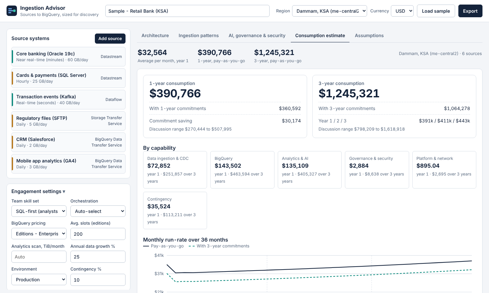

# GCP Ingestion Advisor

A discovery-phase tool for Data & AI architects. Sit with a customer, add the source systems they want in BigQuery, and the advisor:

- **draws the target architecture** live, from source systems through connectivity, CDC / batch ingestion and BigQuery to BI, agents and governance;
- **recommends GCP-native ETL / ELT tooling per source** (Datastream, Dataflow templates, Pub/Sub BigQuery subscriptions, BigQuery Data Transfer Service, Data Fusion, Dataproc Serverless, Storage Transfer, BigQuery Connector for SAP, Mainframe Connector …) based on source type, data type, freshness, location, transformation needs and team skills, with rationale, alternatives and discovery caveats;
- **shows the agentic data cloud on top of BigQuery**: Looker semantic layer, Conversational Analytics and BigQuery data agents, Gemini Enterprise Agent Platform (Agent Engine + Gemini), Gemini Enterprise, model serving on Vertex AI GPU endpoints, Knowledge Catalog (Dataplex) governance, Sensitive Data Protection, CMEK, VPC Service Controls;
- **estimates a ballpark 1-year and 3-year consumption** for the chosen Google Cloud region, pay-as-you-go and with committed-use discounts, by service, capability and source, in USD, SAR, AED, EUR, GBP or INR;
- **exports** a Markdown proposal, a CSV cost breakdown, the architecture as SVG, or a print-ready PDF.


| Ingestion patterns | AI, governance & security | Consumption estimate |
|---|---|---|
|  |  |  |

---

## Deploy in a few clicks

### Option 1 - Open in Cloud Shell (recommended)

[](https://shell.cloud.google.com/cloudshell/editor?cloudshell_git_repo=https://github.com/jithinsl27/jithinsl27-gcp-ingestion-advisor&cloudshell_tutorial=docs/cloudshell-tutorial.md&show=terminal)

Cloud Shell clones this repo and opens a guided tutorial. Pick your project, then run:

```bash
./deploy.sh                      # public URL, us-central1
./deploy.sh --region me-central2 # e.g. deploy in Dammam
./deploy.sh --private            # IAM-protected (no public access)
```

The script enables the required APIs, builds the container with Cloud Build (no local Docker needed) and deploys to Cloud Run. It prints the service URL when it finishes (about 3 minutes the first time).

### Option 2 - Run on Google Cloud button

[](https://deploy.cloud.run/?git_repo=https://github.com/jithinsl27/jithinsl27-gcp-ingestion-advisor)

One click builds and deploys to Cloud Run in the project you choose. Requires the repository to be public.

### Option 3 - CI/CD and infrastructure as code

- `cloudbuild.yaml` - test, build, push to Artifact Registry and deploy. Connect the repo to Cloud Build and add a trigger on `main`.
- `deploy/terraform/` - Artifact Registry, Cloud Run v2 service, runtime service account, invoker IAM and an optional Cloud Build trigger.
- `.github/workflows/deploy.yml` - deploy from GitHub Actions with Workload Identity Federation.

Full details, private access with IAP and troubleshooting: [docs/deployment.md](docs/deployment.md).

### Static demo (no Google Cloud project needed)

`python demo/build_demo.py` produces `demo/dist/index.html`: the whole tool in one file, running in the browser with a JavaScript port of the engine. The `pages.yml` workflow publishes it to GitHub Pages; enable **Settings → Pages → Source: GitHub Actions** and it appears at `https://jithinsl27.github.io/jithinsl27-gcp-ingestion-advisor/`. A parity test keeps the JavaScript engine identical to the Python one.

---

## Run locally

```bash
python -m venv .venv && source .venv/bin/activate
pip install -r requirements-dev.txt
uvicorn app.main:app --reload --port 8080      # open http://localhost:8080
python -m pytest -q                            # 150+ tests incl. JS/Python parity (needs node)
```

or with Docker: `docker build -t ingestion-advisor . && docker run -p 8080:8080 ingestion-advisor`.

## How it works

```
Browser (app/static)  ──POST /api/estimate──▶  FastAPI (app/main.py)
  source canvas, diagram,                         ├─ recommender.py   rules: source → pattern + tools
  tabs, exports                                   ├─ estimator.py     36-month cost simulation
                                                  └─ data/*.json      list prices, regions (editable)
```

- **Stateless.** Nothing is stored server-side; scenarios live in the browser (local storage) and can be saved/opened as JSON.
- **Transparent rules.** `app/recommender.py` is plain if/else per source category; tune it to your practice.
- **Editable prices.** `app/data/pricing.json` and `app/data/regions.json` hold list prices and regional uplifts. Update them without touching code.

See [docs/architecture.md](docs/architecture.md) and [docs/pricing-model.md](docs/pricing-model.md).

## Documentation

| Document | What's in it |
|---|---|
| [User guide](docs/user-guide.md) | Running a discovery session with the tool, every field explained |
| [Demo script](docs/demo-script.md) | A 15-minute customer demo storyline using the samples |
| [Decision matrix](docs/decision-matrix.md) | Which GCP tool is recommended for which source and why |
| [Pricing model](docs/pricing-model.md) | Sizing formulas, assumptions, price sources, how to update |
| [Architecture](docs/architecture.md) | Code structure, API, extending sources and tools |
| [Deployment](docs/deployment.md) | Cloud Shell, Cloud Run button, Cloud Build, Terraform, GitHub Actions, IAP |

## Project layout

```
app/
  main.py             FastAPI app + API models
  catalog.py          source types, GCP tools, pick-lists
  recommender.py      ingestion rules + platform narrative
  estimator.py        1/3-year consumption model
  data/pricing.json   list prices (USD, us-central1 baseline)
  data/regions.json   regions and price uplift
  static/             UI (HTML/CSS/JS, no build step)
samples/              example customer scenarios
demo/                 static demo build + JS engine port
tests/                engine, API and parity tests
deploy/terraform/     IaC deployment
deploy.sh, Dockerfile, app.json, cloudbuild.yaml, .github/workflows/
```

## Important

Estimates are **ballpark figures for discovery conversations**, based on public list prices (reviewed 2026-10-15) and approximate regional uplifts. They exclude taxes, support, egress from other clouds, partner licences (e.g. SAP SLT, Looker, which is quote-based) and negotiated discounts. Validate with the [Google Cloud Pricing Calculator](https://cloud.google.com/products/calculator) before sharing numbers formally.

## License

Apache 2.0 - see [LICENSE](LICENSE).
